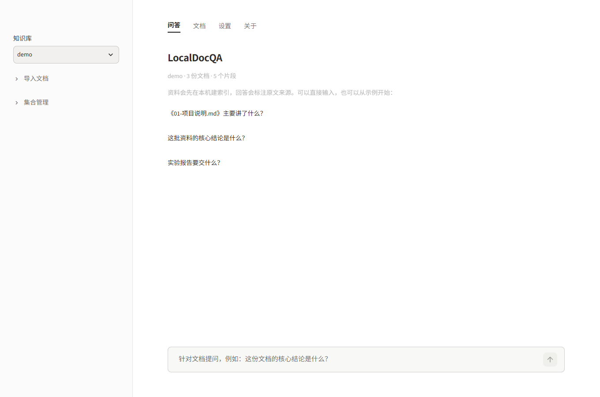
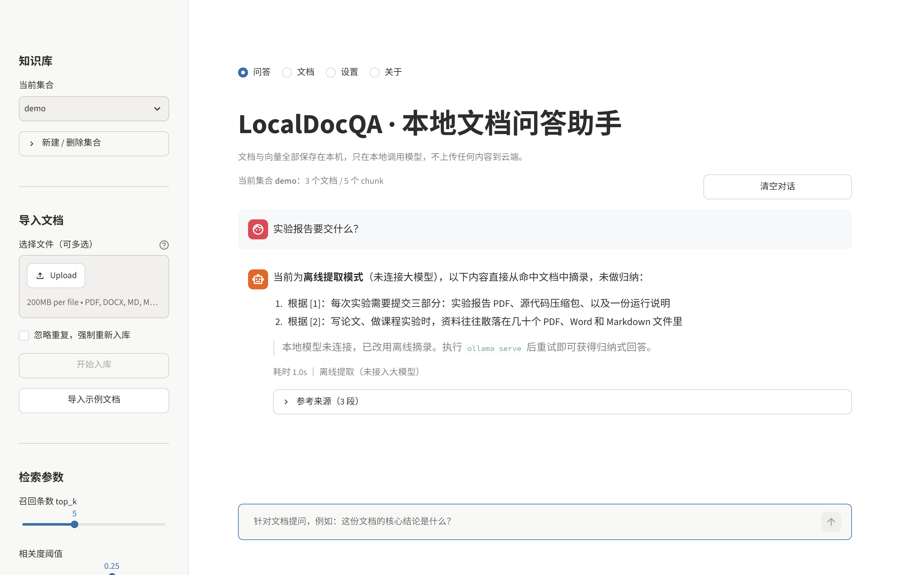
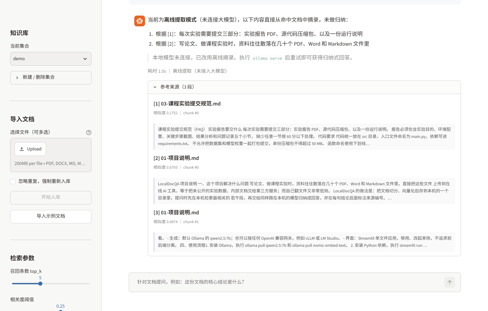
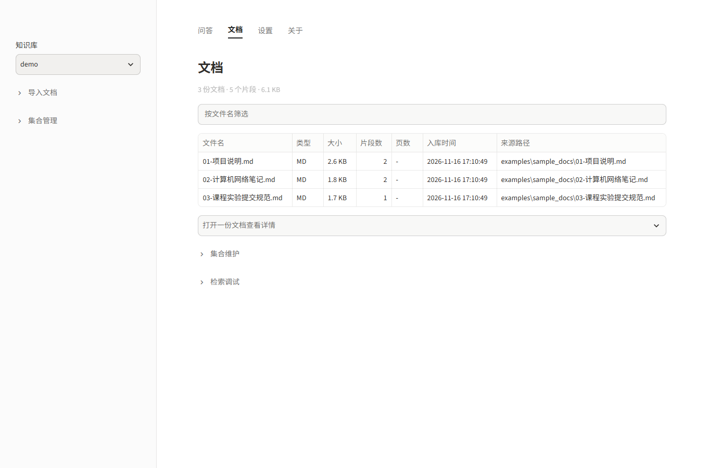

# LocalDocQA

**完全本地运行的文档问答工具。** 把 PDF、Word、Markdown、TXT 等文件切成块、向量化，存进本机的一个目录；
提问时先在本机检索最相关的若干段，再交给本机模型归纳，回答后面跟着 `[1]` `[2]` 这样的来源编号，
能直接对应到文件名、页码和原文片段。文档、向量、对话记录都不离开本机。


---

## 为什么做这个

写论文、做实验的人手上通常有几十份 PDF 和笔记。丢进在线 AI 工具等于把未公开的数据交给第三方；
自己翻文件又太慢。LocalDocQA 只解决这一件事：**让"问自己的文档"这件事在本地完成，并且答案可以回溯到原文。**

它不追求做一个通用聊天机器人，也不做多模态。范围小，所以每一层都能讲清楚、能被改。

## 界面









> 演示视频：[docs/demo.mp4](docs/demo.mp4)（本机真实操作：示例问题 → 回答与来源 → 文档页 → 设置 → 关于）
>
> 截图来自本机真实运行（Windows 11 · Python 3.14.2），当时未安装 Ollama，所以显示的是离线提取模式。
> 装好模型后同一位置显示的是模型归纳结果，但 `[编号]` 与来源列表的结构不变。

---

## 特性

| 能力 | 说明 |
| --- | --- |
| 多格式入库 | PDF（按页保留页码）、DOCX（含表格）、Markdown、TXT、LOG、CSV、JSON、HTML |
| 中文友好的切分 | 分隔符表把中文句号/问号/分号排在前面，优先在句末断开；相邻块保留上下文重叠 |
| 内容级去重 | 以文件 SHA256 为口径，改个文件名重复导入不会污染向量库 |
| 本机向量库 | numpy + 余弦相似度，一个集合一个目录，只有 `chunks.jsonl` / `vectors.npy` / `meta.json` 三个文件 |
| 本地推理 | 默认 Ollama（qwen2.5:7b + nomic-embed-text），也可接任意 OpenAI 兼容网关 |
| 回答可溯源 | 上下文按 `[编号]` 拼接，界面和 CLI 都列出每段的文件名、页码、相似度、原文预览 |
| 来源可读性 | 按提问与原文共有的短语高亮；每段可展开"查看原文"、整段回答可一键复制 |
| 多轮对话 | 按集合落盘到 `data/conversations/`，刷新/重启接着聊；可重新生成上一条回答、导出 Markdown |
| 知识库管理 | 文档详情（分段预览/文件信息/删除）、逐文件入库报告、集合 zip 打包与导入 |
| 空态引导 | 一句说明 + 用当前文档生成的三个示例问题，点一下直接发起提问；有对话后自动退场 |
| 三层降级 | 没有模型 → 原文摘录；没有 embedding 服务 → 离线词法向量；服务报错 → 界面给提示而不是崩溃 |
| 两种入口 | Streamlit 网页界面 + 命令行（`ingest` / `ask` / `search` / `list` / `stats` / `check`） |
| 可评估 | `scripts/eval_rag.py` 用固定问题集算 hit@1、hit@k、关键词召回，结果可落 JSON |
| 工程约束 | 69 项 pytest（含界面冒烟测试）、ruff 静态检查、GitHub Actions 四版本矩阵 + 端到端冒烟 |

---

## 架构

```mermaid
flowchart LR
    A[PDF/DOCX/MD/TXT...] --> B[loader<br/>解析 + 编码识别]
    B --> C[splitter<br/>中文友好切分]
    C --> D[embeddings<br/>Ollama / 离线哈希]
    D --> E[(本机向量库<br/>chunks + vectors + meta)]

    Q[提问] --> R[embeddings<br/>查询向量]
    R --> S[retrieval<br/>余弦召回 + 相邻块扩展]
    E --> S
    S --> T[prompt 拼装<br/>[1] 来源：文件/页码]
    T --> U[llm<br/>Ollama / OpenAI 兼容]
    U --> V[回答 + 来源列表]
```

三个关键设计：

1. **检索和生成解耦。** `search` 子命令只做检索、不生成，调 prompt 或换模型时不用重新入库。
2. **落盘格式即对象格式。** 向量库里存的就是 `Chunk` 的字段，打开 jsonl 能直接看懂，出问题不用猜。
3. **降级是设计的一部分，不是补丁。** 每条路径都有对应的可读提示，而不是让界面崩在一堆 traceback 上。

更细的模块职责、数据结构与扩展点见 [docs/ARCHITECTURE.md](docs/ARCHITECTURE.md)。

---

## 快速开始

### 1. 环境要求

- Python 3.10+（3.13 已验证）
- 可选：[Ollama](https://ollama.com/download)，用于本地语义向量与回答生成
- 磁盘：向量库大小约为原始文本的 3~4 倍（768 维 float32）

### 2. 安装 Ollama 与模型（不装也能用，会退化成原文摘录模式）

```bash
ollama serve                     # 一般安装后自动作为服务运行
ollama pull qwen2.5:7b           # 回答模型，约 4.7 GB
ollama pull nomic-embed-text     # 向量模型，约 274 MB
```

显存 8 GB 卡建议 7b；只有 4 GB 可用 `qwen2.5:3b`，把 `config.yaml` 里的 `llm.model` 改掉即可。

### 3. 安装依赖

```bash
git clone https://github.com/ElysVow/LocalDocQA.git
cd LocalDocQA
python -m venv .venv
# Windows: .venv\Scripts\activate    macOS/Linux: source .venv/bin/activate
pip install -e ".[ui]"               # 只要命令行可省略 [ui]
cp config.example.yaml config.yaml   # Windows: copy config.example.yaml config.yaml
```

### 4. 网页界面

```bash
streamlit run app.py
```

浏览器打开 `http://localhost:8501`，左侧新建集合（例如"毕业论文"）→ 上传文件 → 等入库完成 → 在对话框提问。
每条回答下方会展开"参考来源"，列出文件名、页码、相似度与原文预览。

### 5. 命令行

```bash
# 环境自检：依赖、模型服务、向量化、数据目录
python -m localdocqa check

# 入库（目录会递归扫描，支持多路径）
python -m localdocqa ingest ./papers ./notes -c 毕业论文
python -m localdocqa ingest examples/sample_docs -c demo

# 提问（流式输出，末尾附来源）
python -m localdocqa ask "TCP 三次握手为什么需要三次" -c 毕业论文
python -m localdocqa ask "这份实验报告的截止时间" -c demo --no-stream --json

# 只看检索结果，不生成
python -m localdocqa search "TIME-WAIT 为什么等 2MSL" -c demo -k 3

# 查看集合与文档
python -m localdocqa stats
python -m localdocqa list -c demo
```

### 6. Windows 双击运行

仓库根目录带了两个批处理，双击即可，不需要手动激活虚拟环境：

| 文件 | 作用 |
| --- | --- |
| `start.bat` | 启动网页界面，浏览器自动打开 `http://localhost:8501` |
| `shell.bat` | 打开命令行窗口并激活 `.venv`，可直接输入 `localdocqa ...` |

两者都假定项目根目录已有 `.venv`（第 3 步创建的）。首次打开时集合是空的，展开侧边栏的「导入文档」，
点「先导入 3 份示例文档」即可在几秒内建立 demo 索引；也可以直接新建集合上传自己的资料。

---

## 配置

所有配置项都有默认值，`config.yaml` 只需写要覆盖的部分（与默认值深合并）。
完整注释版见 [config.example.yaml](config.example.yaml)。

| 配置项 | 默认 | 说明 |
| --- | --- | --- |
| `llm.provider` | `ollama` | `ollama` / `openai` / `none`（none = 不调模型，直接摘录原文） |
| `llm.model` | `qwen2.5:7b` | 本地模型名 |
| `llm.max_context_chars` | `6000` | 拼进 prompt 的参考资料上限，超长会截断尾部段落 |
| `embeddings.provider` | `ollama` | `ollama` / `hash`（hash = 离线词法向量，无需模型） |
| `embeddings.fallback_to_hash` | `true` | Ollama 不可用时是否自动降级 |
| `chunking.size` / `overlap` | `800` / `120` | 切块目标长度与重叠；实际块上限为 `size + overlap` |
| `retrieval.top_k` | `5` | 召回条数 |
| `retrieval.score_threshold` | `0.25` | 语义模式的余弦阈值，调低提高召回 |
| `retrieval.lexical_relative_cutoff` | `0.25` | 离线词法模式的相对阈值（相对最高分） |
| `retrieval.expand_neighbors` | `1` | 命中块的前后相邻块一并进入上下文 |

环境变量（便于容器/CI）：`OLLAMA_BASE_URL`、`LOCALDOCQA_DATA_DIR`、`LOCALDOCQA_CONFIG`。

---

## 实测数据

仓库内 `examples/eval_set.jsonl` 有 8 个问题（覆盖 3 份示例文档），用 `scripts/eval_rag.py` 复现：

```bash
python -m localdocqa ingest examples/sample_docs -c demo
python scripts/eval_rag.py -c demo -k 5 --out docs/eval-report.json
```

本机（Windows 11 / Python 3.13，**未安装 Ollama，走离线词法向量**）实测：

| 指标 | 数值 |
| --- | --- |
| hit@1 | 0.625 |
| hit@5 | 0.875 |
| 关键词召回 | 0.875 |

需要说明两点：

- 这组数字来自**离线词法向量**（二字组合哈希），不是语义模型，同义改写的问法召回不到属于预期行为；
  接上 `nomic-embed-text` 后的语义召回本机未验证，README 不写没有测过的数字。
- 评估集只有 8 题，够用来发现"改坏了"，不足以证明模型好坏；继续扩充评估集仍是后续任务。

---

## 目录结构

```
LocalDocQA/
├── app.py                      Streamlit 界面入口
├── config.example.yaml         配置模板（复制为 config.yaml）
├── src/localdocqa/
│   ├── config.py               默认值 + 深合并 + 环境变量
│   ├── loader.py               各格式解析、编码识别、输入解析
│   ├── splitter.py             中文友好递归切分
│   ├── embeddings.py           Ollama 向量 / 离线哈希向量
│   ├── vector_store.py         向量库 + 集合管理
│   ├── llm.py                  Ollama / OpenAI 兼容客户端
│   ├── rag_chain.py            检索 + 上下文 + prompt + 流式 + 降级
│   ├── ingest.py               入库、去重、文档登记、删除
│   ├── text_utils.py           清洗、预览、来源短语高亮
│   ├── conversations.py        按集合落盘的对话记录
│   ├── archive.py              集合 zip 导出/导入
│   └── cli.py                  命令行子命令
├── scripts/
│   ├── eval_rag.py             检索质量评估
│   └── smoke_test.py           端到端冒烟（不依赖模型，CI 里跑）
├── tests/                      69 项 pytest
├── examples/
│   ├── sample_docs/            3 份示例文档（可直接入库体验）
│   └── eval_set.jsonl          评估问题集
└── docs/                       ARCHITECTURE / ROADMAP / FAQ / 评估结果
```

运行时数据（已在 `.gitignore` 中排除）：

```
data/collections/<集合>/chunks.jsonl     文本分块，一行一个
data/collections/<集合>/vectors.npy      归一化向量矩阵
data/collections/<集合>/documents.json   文档登记表（含 SHA256）
data/conversations/<集合>.json           对话记录（每集合一个文件）
data/uploads/                            网页上传的原始文件
```

---

## 测试

```bash
pip install -e ".[dev]"
ruff check .                 # 静态检查
pytest                       # 单元测试 + 界面冒烟（AppTest 真实执行 app.py）
python scripts/smoke_test.py # 端到端：入库 → 检索 → 回答 → 重复入库 → 降级
```

CI 在 3.10/3.11/3.12/3.13 四个版本上跑 lint + 测试，另有一个 job 专跑端到端冒烟。
由于 CI 没有 GPU 也没有模型，全部测试都基于离线向量，不下载任何模型权重。

---

## 已知限制

- 扫描版 PDF 没有文字层，当前版本不进 OCR，会明确提示"未提取到文本"。
- 单集合建议 ≤ 2000 个文档；再大请换 FAISS，`VectorStore.search()` 的接口可以保持不变。
- 纯向量召回，没有关键词混合检索与重排，缩写/编号类查询召回不稳。
- 7B 模型在多跳问题（需要跨 3 段以上拼接）上容易漏步骤，`expand_neighbors` 能缓解一部分。
- 中文长文档的页码只对 PDF 有效，DOCX 与 Markdown 没有页概念，来源会显示文件名。

---

## 更新日志

版本变更见 [CHANGELOG.md](CHANGELOG.md)，首个公开版本说明见 [docs/release-v0.2.0.md](docs/release-v0.2.0.md)。

---

## 路线图

短期与中期计划见 [docs/ROADMAP.md](docs/ROADMAP.md)。当前 v0.2 已完成：多格式入库、增量去重、本机向量库、
带引用的问答、流式输出、多轮对话落盘、来源高亮与原文、文档详情、集合打包导入导出、CLI/Web 双入口、评估脚本、
69 项测试与 CI。

---

## 贡献

欢迎 issue 和 PR，先看 [CONTRIBUTING.md](CONTRIBUTING.md)。有两类改动尤其欢迎：
扩充 `examples/eval_set.jsonl` 的评估问题（附上期望文档），以及补充真实文档格式的解析用例（脱敏后）。

---

## License

MIT，见 [LICENSE](LICENSE)。

---

## English summary

LocalDocQA is a fully local document QA tool. It parses PDFs, Word files, Markdown and plain text, splits them
with a Chinese-aware recursive splitter, embeds the chunks with either Ollama (`nomic-embed-text`) or a
dependency-free hashing fallback, and stores them in a numpy-backed vector store on your own disk. Questions are
answered by a local LLM (Ollama by default, any OpenAI-compatible endpoint as an option) using retrieved context,
and every claim is annotated with `[n]` citations that map back to file name, page number and the exact excerpt.
Nothing is uploaded. If no model is available, the tool degrades to an extractive mode instead of failing.

```bash
pip install -e ".[ui]"
ollama pull qwen2.5:7b && ollama pull nomic-embed-text
python -m localdocqa ingest ./docs -c demo
python -m localdocqa ask "What are the acceptance criteria?" -c demo
streamlit run app.py
```
